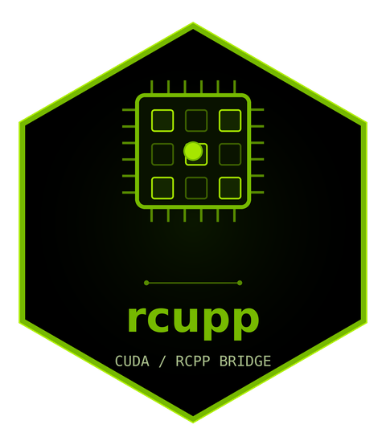

# rcupp



[](https://github.com/shajoezhu/rcupp/actions/workflows/check.yaml)

A lightweight, low-level **Rcpp/CUDA bridge** that exposes a fixed set of GPU
linear-algebra operators and a GPU **FISTA** solver for the Gaussian lasso. It is
also a small, **reusable CUDA-for-Rcpp framework**: a public C API lets other R
packages call its operators and sessions from their own C++ code via
`LinkingTo: rcupp`, without shipping any CUDA of their own.

`rcupp` is the foundation of the [cudaGlmnet](https://github.com/shajoezhu/cudaGlmnet)
family. It is intentionally low-level — for a glmnet-style front end, use
`cudaGlmnet` instead.

## What it provides

- **Fixed GPU operators** — `gemv` / `gemv_t` / `axpy` / `scal` / `dot` /
  `nrm2` / `soft_threshold`, backed by cuBLAS and one custom kernel.
- **GPU FISTA lasso solver** — the whole iteration loop stays on the device
  (one host→device copy of `X`/`y` at the start, one copy of `beta` back at the
  end).
- **Session API** — persistent device `X`, a reusable cuBLAS handle, the work
  buffers, and the cached Lipschitz constant `L` are kept resident across many
  fits. This removes the per-call setup that dominates lambda paths and
  cross-validation. Cold-start fits are bit-identical to the one-shot solver;
  `warm_start` is opt-in.
- **Public C API** (`inst/include/rcupp.h`) — `R_RegisterCCallable` /
  `R_GetCCallable` so downstream packages can `LinkingTo: rcupp` and call the
  operators and the session ABI from their own C++.
- **Optional CUDA** — with no CUDA Toolkit at build time, a supported CPU
  fallback implements the *same* solver and the *same* public C API (including
  sessions). The package stays installable, runnable and checkable everywhere;
  there is no user-facing backend switch, a fit just records `backend`
  (`"cuda"` or `"cpu-shim"`).

## Installation

The CUDA Toolkit (>= 12.x) is **optional**. `configure` auto-detects it in the
order `--with-cuda-home` → `$CUDA_HOME` → `$CUDA_PATH` → `nvcc` on `PATH` →
`/usr/local/cuda`, and builds the GPU backend only when a usable toolkit is
found; otherwise it builds the CPU fallback.

```r
# install.packages("remotes")
remotes::install_github("shajoezhu/rcupp")

# force a specific toolkit (optional; otherwise auto-detected):
# remotes::install_github("shajoezhu/rcupp",
#   configure.args = "--with-cuda-home=/usr/local/cuda")
```

Requires a C++17 compiler (`SystemRequirements: C++17`). `Rcpp` and
`RcppArmadillo` are linked at build time. To check which backend is active:

```r
rcupp::cuda_available()   # TRUE = GPU build, FALSE = CPU fallback
```

## Quick start

```r
library(rcupp)
set.seed(1)
X <- matrix(rnorm(100 * 5), 100, 5)
y <- drop(X %*% c(2, -1, 0, 0, 0)) + rnorm(100)

# One-shot fit (GPU or CPU fallback, identical numerics)
fit <- lasso_fista(X, y, lambda = 0.05)
fit$beta
fit$iterations
fit$backend        # "cuda" or "cpu-shim"

# Reuse device state across a whole lambda path / CV
s <- lasso_session()
session_set_data(s, X, y)
b1 <- session_fit(s, lambda = 0.10)$beta
b2 <- session_fit(s, lambda = 0.05)$beta
b3 <- session_fit(s, lambda = 0.01, warm_start = TRUE)$beta
session_destroy(s)
```

## Using the public C API from another package

A downstream package needs no CUDA code and no CUDA build logic of its own:

```
# DESCRIPTION
Imports: rcupp, Rcpp
LinkingTo: rcupp, Rcpp
NeedsCompilation: yes
```

`LinkingTo: rcupp` adds `-I<rcupp>/include` automatically — **no `src/Makevars`
is required**. Include `<rcupp.h>` and call the `static inline` wrappers, which
resolve the real implementation at runtime through `R_GetCCallable`:

```cpp
#include <Rcpp.h>
#include <rcupp.h>

// [[Rcpp::export]]
Rcpp::NumericVector my_gemv(Rcpp::NumericMatrix X, Rcpp::NumericVector v) {
  int n = X.nrow(), p = X.ncol();
  std::vector<double> out(n);
  rcupp_gemv(X.begin(), n, p, v.begin(), out.data());   // out = X %*% v
  return Rcpp::wrap(out);
}
```

Every pointer is a host `double*` and `X` is `n x p` column-major (R order).
For persistent device residency use the session C ABI
(`rcupp_session_create` / `rcupp_session_set_data` / `rcupp_session_fit` /
`rcupp_session_destroy`). Reference something from `rcupp` (e.g.
`cuda_available()`) in R before the C++ runs so its DLL and registrations are
loaded. Two complete working examples are
[cudaBio](https://github.com/shajoezhu/cudaBio) and
[cudaFin](https://github.com/shajoezhu/cudaFin). The `getting-started` vignette
has a fuller walkthrough.

## Numerical contract

Identical in the GPU build, the CPU fallback and the pure-R reference oracle:

```
F(beta) = 1/(2n) ||y - X beta||^2 + lambda ||beta||_1
L       = lambda_max(X^T X) / n            (power iteration)
u       = z + (1/(L n)) X^T (y - X z);  beta+ = S_{lambda/L}(u)
momentum: t+ = (1+sqrt(1+4 t^2))/2 ; z+ = beta+ + ((t-1)/t+)(beta+ - beta)
```

## Part of the cudaGlmnet family

| Package | Role | Link |
|---|---|---|
| **rcupp** | low-level Rcpp/CUDA bridge + reusable operator/session framework | this repo |
| cudaGlmnet | glmnet-style GPU lasso front end (lambda path, CV, `coef`/`predict`) | [github](https://github.com/shajoezhu/cudaGlmnet) |
| cudaBio | PCA / GWAS power iteration (`p >> n`) downstream example | [github](https://github.com/shajoezhu/cudaBio) |
| cudaFin | rolling-window lasso forecasting downstream example | [github](https://github.com/shajoezhu/cudaFin) |

## License

Apache License 2.0.
